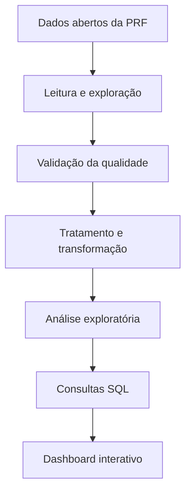

# Análise de Acidentes nas Rodovias Federais da Bahia

Projeto de análise de dados públicos da Polícia Rodoviária Federal (PRF), com foco nos acidentes registrados nas rodovias federais da Bahia entre 2019 e 2025. O trabalho envolve exploração e validação dos dados, desenvolvimento de análises com Python, consultas SQL e visualização de resultados.

---

## Sobre o projeto

Como os dados públicos de acidentes rodoviários podem ajudar a compreender os padrões dos acidentes nas rodovias federais da Bahia?

Este projeto busca responder a essa pergunta por meio da análise dos dados disponibilizados pela PRF, investigando características temporais, geográficas e circunstanciais dos acidentes.

Além da análise exploratória, o desenvolvimento considera a qualidade dos dados e a documentação das decisões técnicas, buscando construir uma base confiável para a produção de indicadores.

## Fonte dos dados

- **Origem:** [Dados Abertos da PRF](https://www.gov.br/prf/pt-br/acesso-a-informacao/dados-abertos/dados-abertos-da-prf)
- **Período:** 2019–2025
- **Abrangência da análise:** rodovias federais da Bahia
- **Formato original:** CSV
- **Granularidade:** registros agrupados por pessoa

> **Importante:** uma linha da base não representa necessariamente um acidente único. Um mesmo acidente pode aparecer em vários registros, correspondentes às pessoas envolvidas. Essa característica precisa ser considerada na construção dos indicadores.

## O que será investigado?

- Distribuição dos acidentes ao longo dos anos e dos períodos do dia.
- Distribuição geográfica por município e trecho rodoviário.
- Causas e tipos de acidentes.
- Condições meteorológicas, características da via e circunstâncias dos acidentes.
- Situação das pessoas envolvidas e indicadores relacionados às vítimas.
- Qualidade, consistência e limitações dos dados utilizados.

As perguntas e os indicadores serão refinados durante a exploração dos dados, conforme as informações disponíveis e sua confiabilidade.

## Fluxo de trabalho

